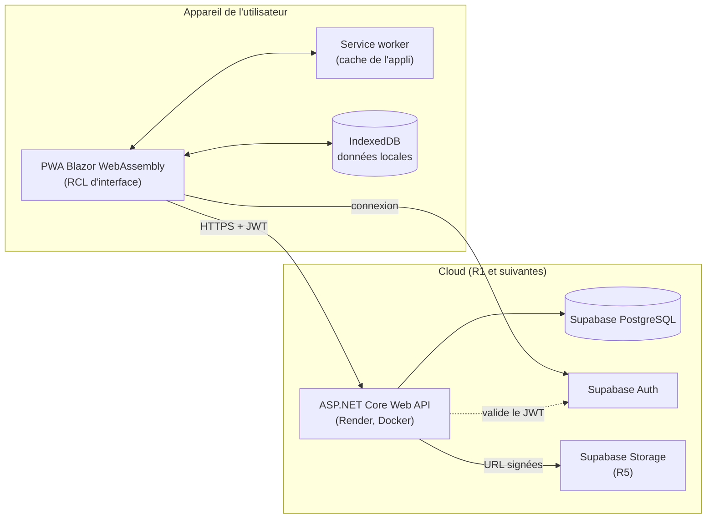
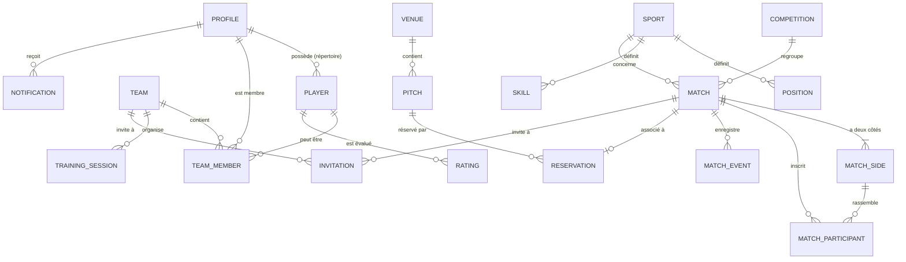

# AlFariq — Spécifications techniques

Version 0.1 — 22/11/2026
Statut : brouillon à valider
Documents liés : `AlFariq-user-stories.md`, `AlFariq-specifications-fonctionnelles.md`

> Les offres d'hébergement (limites des formules gratuites, tarifs) et les numéros de version changent souvent. Tout ce qui est marqué **[à vérifier]** doit être confirmé auprès de la documentation officielle avant décision.

---

## 1. Contexte, contraintes et objectifs

| Élément | Valeur |
|---|---|
| Équipe | **1 développeur .NET** |
| Livraison initiale | **PWA** installable, fiable même sans réseau |
| Première version | **Entièrement hors ligne** possible (R0) |
| Évolution | Application mobile (notifications, localisation) et desktop (organisateurs) |
| Base de données et authentification envisagées | **Supabase** |
| Backend envisagé | **Render** |
| Code source | **GitHub ou GitLab** |
| Budget | Faible : formules gratuites ou bon marché au démarrage |

**Objectifs techniques**
1. Un seul langage et un seul écosystème (.NET) pour limiter la charge d'un développeur seul.
2. Une **architecture offline-first** : l'appli fonctionne d'abord avec ses données locales, la synchronisation est un ajout.
3. Un **code d'interface réutilisable** pour les futures applications mobile et desktop.
4. Une **migration sans douleur** de R0 (local) vers R1 (compte, cloud) : mêmes identifiants, mêmes entités.
5. Des coûts et une exploitation maîtrisés.

---

## 2. Décisions d'architecture (synthèse)

| # | Décision | Choix recommandé | Alternatives écartées |
|---|---|---|---|
| D1 | Technologie du client | **Blazor WebAssembly** en mode autonome (standalone) avec modèle PWA | Blazor Server (pas de hors ligne), React/Angular (2 langages), Flutter (autre langage) |
| D2 | Réutilisation native | Interface dans une **bibliothèque de classes Razor (RCL)**, réutilisable par **.NET MAUI Blazor Hybrid** en R6 | Réécriture native |
| D3 | Stockage local | **IndexedDB** derrière une interface de dépôt | `localStorage` (trop limité), SQLite WASM (plus lourd, à réévaluer) |
| D4 | Backend | **ASP.NET Core Web API** (R1), conteneur Docker | Accès direct du client à Supabase (voir § 4.3) |
| D5 | Base de données | **PostgreSQL de Supabase**, accès via **EF Core + Npgsql** | Base sur Render |
| D6 | Authentification | **Supabase Auth**, jetons JWT validés par l'API | Identity maison |
| D7 | Fichiers (photos) | **Supabase Storage** (R5) | Stockage sur Render |
| D8 | Identifiants | **GUID générés côté client** (version 7 conseillée) | Identifiants auto-incrémentés |
| D9 | Résolution de conflits | **Dernière modification gagnante** par entité (R1), fusion fine plus tard | CRDT (trop complexe pour démarrer) |
| D10 | Hébergement du client | **Site statique** (GitHub Pages, Cloudflare Pages ou Render Static) | Servi par l'API |
| D11 | Code source et CI | **GitHub + GitHub Actions** (recommandé) ; GitLab CI équivalent | — |

### 2.1 Pourquoi Blazor WebAssembly
**Avantages** : un seul langage (C#) côté client et serveur ; **contrats partagés** (modèles et validation) entre l'appli et l'API ; fonctionnement hors ligne via service worker ; modèle PWA fourni ; réutilisation possible dans MAUI Blazor Hybrid.

**Inconvénients à connaître**
- **Téléchargement initial** plus volumineux qu'un framework JavaScript (plusieurs Mo à la première visite, ensuite mis en cache). Mesures : compression Brotli, élagage (trimming), chargement différé des assemblages, éviter la compilation AOT au début (elle augmente la taille).
- **Pas de rendu serveur** : les liens partagés (invitation, page de match) n'auront pas d'aperçu riche dans WhatsApp. Solution : des **pages d'aperçu minimales servies par l'API** (balises Open Graph), qui redirigent ensuite vers l'application (voir § 8.4).
- **Notifications push sur iOS** : possibles seulement pour une PWA installée sur l'écran d'accueil **[à vérifier]**.
- **Stockage local** sur iOS : le navigateur peut effacer les données d'un site peu utilisé ; une PWA installée est mieux protégée **[à vérifier]**. D'où l'export/import (US-015) et la demande de stockage persistant.

### 2.2 Version de .NET
Utiliser la **dernière version à support long terme (LTS)** disponible au démarrage du projet **[à vérifier]**, et planifier les mises à jour majeures chaque année.

---

## 3. Vue d'ensemble de l'architecture



- **R0** : seul le bloc « Appareil » existe. Aucune dépendance serveur.
- **R1+** : l'API devient le point d'accès unique aux données partagées ; le client continue de lire et d'écrire d'abord en local.

---

## 4. Choix détaillés

### 4.1 Structure de la solution

```
AlFariq.sln
├─ src/
│  ├─ AlFariq.Domain          Entités, règles métier, algorithmes (équilibrage, statistiques) — sans dépendance externe
│  ├─ AlFariq.Contracts       DTO et validateurs partagés client/serveur
│  ├─ AlFariq.Application     Cas d'usage (commandes, requêtes), interfaces de dépôt
│  ├─ AlFariq.Client.Core     Stockage local (IndexedDB), moteur de synchronisation, services du client
│  ├─ AlFariq.UI              Bibliothèque de classes Razor : composants et pages réutilisables (futur MAUI)
│  ├─ AlFariq.Web             Hôte Blazor WebAssembly (PWA) : composition, service worker, manifeste
│  ├─ AlFariq.Infrastructure  EF Core, Npgsql, accès Supabase, stockage de fichiers (R1+)
│  └─ AlFariq.Api             API ASP.NET Core (R1+)
└─ tests/
   ├─ AlFariq.Domain.Tests
   ├─ AlFariq.Application.Tests
   ├─ AlFariq.UI.Tests        (bUnit)
   ├─ AlFariq.Api.Tests       (tests d'intégration)
   └─ AlFariq.E2E.Tests       (Playwright)
```

**Règles**
- Le domaine ne dépend de rien d'autre. L'algorithme d'équilibrage et le calcul des statistiques y vivent : ils fonctionnent **à l'identique en local et sur le serveur**.
- `Contracts` est la seule référence commune entre client et API.
- Pas de logique métier dans les pages Razor : elles appellent des services de l'application.

### 4.2 Pourquoi une API .NET plutôt que le client direct vers Supabase
Deux approches sont possibles pour R1.

| Critère | **A. API ASP.NET Core** (recommandée) | **B. Client direct vers Supabase** (PostgREST + règles RLS) |
|---|---|---|
| Logique métier (liste d'attente, promotion, équilibrage, droits fins) | En C#, testable | À écrire en SQL ou fonctions de base de données |
| Cohérence avec la compétence de l'équipe | Forte | Faible (SQL avancé, RLS) |
| Sécurité | Contrôles centralisés dans l'API | Repose sur des règles RLS correctes sur chaque table |
| Quantité de code | Plus importante | Moindre au démarrage |
| Coût / exploitation | Un service de plus à héberger | Pas de service supplémentaire |
| Démarrage à froid (formule gratuite d'hébergement) | Oui **[à vérifier]** | Non |
| Réutilisation en R6 (mobile) | API réutilisée telle quelle | Possible aussi |

**Recommandation :** approche A. Elle correspond mieux à un développeur .NET unique et à des règles métier riches (rôles contextuels, liste d'attente, confidentialité des évaluations). Une approche hybride reste possible : Supabase Auth et Storage utilisés directement, les données métier passant par l'API.

### 4.3 Accès aux données et sécurité côté base
- L'API se connecte à PostgreSQL avec **EF Core + Npgsql**. Toute l'autorisation est faite dans l'API.
- Sur Supabase, activer les règles de sécurité au niveau des lignes (**RLS**) sur toutes les tables avec une politique de **refus par défaut** pour les rôles publics : ainsi, même si la clé publique du projet est exposée au navigateur, aucune table n'est lisible directement.
- Utiliser la chaîne de connexion adaptée à un service à démarrage et arrêt fréquents (pooler de connexions) et **tester Npgsql avec le mode du pooler choisi** (session ou transaction) **[à vérifier]**.
- Les migrations sont gérées par EF Core et appliquées par la CI (jamais à la main en production).

### 4.4 Authentification
- Inscription et connexion via **Supabase Auth** (lien magique et mot de passe ; Google en option).
- Le client reçoit un **JWT** et un jeton de renouvellement ; l'API **valide la signature** (clés JWKS ou secret selon la configuration du projet Supabase **[à vérifier]**) et lit l'identifiant de l'utilisateur dans le jeton.
- Le profil applicatif (`profile`) est lié à l'utilisateur d'authentification par `user_id`.
- En R0, aucune authentification : les données sont rattachées à un `OwnerId` local, remplacé à la migration (US-023).

---

## 5. Conception hors ligne et synchronisation

### 5.1 Principes
1. **L'application lit et écrit toujours dans la base locale.** L'interface ne parle jamais directement à l'API pour les données métier.
2. Un **moteur de synchronisation** en arrière-plan échange les changements avec l'API.
3. **Les identifiants sont créés côté client** (GUID) : une entité créée hors ligne a déjà son identifiant définitif.
4. Les suppressions sont **logiques** (`DeletedAt`) pour pouvoir être propagées.

### 5.2 Champs communs à toutes les entités synchronisées
| Champ | Rôle |
|---|---|
| `Id` | GUID créé côté client (version 7 conseillée : triable par date). |
| `OwnerId` | Propriétaire (identifiant local en R0, identifiant de profil en R1+). |
| `CreatedAt`, `UpdatedAt` | Dates en UTC. |
| `DeletedAt` | Suppression logique. |
| `Version` | Numéro de version incrémenté par le serveur (contrôle de concurrence). |
| `DeviceId` | Appareil à l'origine de la dernière modification (diagnostic). |

### 5.3 Stockage local
- **IndexedDB**, un magasin d'objets par type d'entité, avec index sur les champs de recherche (date de match, nom de joueur, statut).
- Interface `IRepository<T>` avec deux implémentations : **locale** (R0) et **synchronisée** (R1). Le reste de l'application ne connaît que l'interface.
- **Versionnement de schéma** : numéro de version de la base locale et migrations exécutées au démarrage.
- Demande de **stockage persistant** (`navigator.storage.persist()`) au premier lancement et après une action significative.
- Une bibliothèque Blazor peut encapsuler IndexedDB ; elle sera choisie sur critères de maintenance et de licence, **derrière notre interface** pour rester remplaçable.

### 5.4 Protocole de synchronisation (R1)
1. **File d'attente sortante (outbox)** : chaque écriture locale ajoute une opération (type, entité, charge utile, horodatage, identifiant unique d'opération).
2. **Envoi** : `POST /api/v1/sync/push` avec un lot d'opérations. Le serveur applique chaque opération **de façon idempotente** (identifiant d'opération déjà vu = ignoré) et répond avec le résultat par opération.
3. **Réception** : `GET /api/v1/sync/pull?since={curseur}` retourne les entités modifiées depuis le curseur (dont les suppressions logiques), paginées.
4. **Curseur** : valeur croissante fournie par le serveur (par exemple un numéro de séquence global), pas l'horloge du client.
5. **Conflits** : si la `Version` envoyée est inférieure à celle du serveur, la règle « dernière modification gagnante » s'applique sur `UpdatedAt` serveur ; le conflit est journalisé et signalé à l'utilisateur.
6. **Reprise** : en cas d'échec réseau, les opérations restent dans l'outbox avec une attente progressive entre les tentatives.
7. **Déclenchement** : au démarrage, au retour du réseau, après chaque modification (avec regroupement) et à intervalles réguliers lorsque l'appli est ouverte. L'API de synchronisation en arrière-plan du navigateur n'est pas disponible partout : ne pas en dépendre.

### 5.5 Points de vigilance
- **Granularité** : synchroniser les listes (participants d'un match) comme des **entités séparées** pour limiter les conflits.
- **Règles métier concurrentes** (liste d'attente, capacité) : arbitrées **par le serveur**. Le client affiche un état « en attente de confirmation » tant que le serveur n'a pas validé.
- **Horloges** : ne jamais faire confiance à l'heure de l'appareil pour l'ordre des changements ; la source de vérité est le serveur.
- **Migration R0 → R1** (US-023) : réaffecter `OwnerId`, conserver les `Id`, envoyer en lots, vérifier l'idempotence.
- **Premier chargement hors ligne** : aucune donnée serveur n'est disponible tant qu'une première synchronisation n'a pas eu lieu ; l'interface l'indique.

### 5.6 Service worker et mises à jour
- Utiliser le service worker du modèle PWA Blazor (mise en cache des ressources avec manifeste d'actifs).
- **Stratégie** : ressources de l'appli en « cache d'abord » ; appels API jamais mis en cache par le service worker (la synchronisation est gérée par l'application).
- **Mise à jour** : détecter une nouvelle version, proposer « Recharger », éviter de recharger pendant une saisie.
- **Compatibilité des versions** : le serveur accepte plusieurs versions du client (champs optionnels, version d'API `v1`) pour éviter de bloquer des appareils qui n'ont pas encore rechargé.

---

## 6. Modèle de données

### 6.1 Entités principales



### 6.2 Entités et champs clés

| Entité | Champs principaux | Release |
|---|---|---|
| `sport` | code, nom, joueurs par côté par défaut | R0 |
| `profile` | user_id (compte), nom affiché, sport par défaut, poste préféré, bio, visibilité, niveau de validation | R0 (local) / R1 |
| `player` | propriétaire, profil lié (nullable), nom, poste préféré, niveau perçu, archivé | R0 |
| `position` | sport, code, nom, zone (gardien, défense, milieu, attaque) | R0 |
| `match` | sport, organisateur, date et heure, durée, format, lieu (texte), terrain (nullable), statut, visibilité, capacité, compétition (nullable), notes | R0 |
| `match_side` | match, libellé (A/B), nom, couleur, équipe (nullable), formation, score | R0 |
| `match_participant` | match, joueur ou profil, statut, côté (nullable), poste, emplacement, remplaçant, rang d'attente | R0 (simplifié) / R1 |
| `match_event` | match, participant, type (but, passe), minute | R0 |
| `team` | nom, sport, couleur, créateur | R1 |
| `team_member` | équipe, profil ou joueur, rôles | R1 |
| `invitation` | cible (équipe ou match), jeton (haché), expiration, utilisations max, statut | R1 |
| `notification` | destinataire, type, charge utile, lue le | R1 |
| `venue`, `pitch` | adresse, coordonnées, surface, format, coût horaire, horaires | R2 |
| `reservation` | terrain, match, créneau, statut, coût, responsable | R2 |
| `skill` | sport, nom, équipe (nullable pour les compétences personnalisées) | R3 |
| `rating` | auteur, joueur évalué, contexte (match, compétition, global), dimension (poste, compétence, globale), note, commentaire, visibilité | R3 |
| `report` | élément signalé, auteur, motif, statut | R3 |
| `training_session`, `training_attendance` | équipe, date, lieu, objectif ; présences | R4 |
| `competition`, `competition_team` | format, règles de points, équipes, statut | R4 |
| `photo` | propriétaire, cible, chemin de stockage, taille | R5 |
| `profile_verification` | profil, type, statut, vérificateur | R5 |
| `sync_change` | séquence, entité, type d'opération (table de suivi des changements) | R1 |

### 6.3 Conventions
- Noms de tables et colonnes en `snake_case` (PostgreSQL) ; propriétés en `PascalCase` côté C#.
- Dates en `timestamptz` (UTC). Montants en `numeric`, jamais en flottants.
- Clés primaires `uuid` ; clés étrangères indexées.
- Les statuts sont des **énumérations stockées en texte** (lisibles et évolutives).
- Les entités de catalogue (sports, postes, compétences) sont **versionnées par migration** et fournies avec l'application en R0.
- Les calculs de statistiques et de classement sont **dérivés** (jamais stockés), sauf optimisation mesurée.

---

## 7. API (R1 et suivantes)

### 7.1 Conventions
- REST, JSON, préfixe `/api/v1`.
- Authentification par jeton porteur (JWT Supabase) ; autorisation par politiques fondées sur les ressources (« est organisateur du match », « est membre de l'équipe »).
- Erreurs au format **Problem Details** (norme RFC 9457) avec code stable, message et identifiant de corrélation.
- Pagination par curseur pour les listes ; filtres par paramètres de requête.
- Contrôle de concurrence par `Version` (ETag).
- Documentation **OpenAPI** générée automatiquement.
- Idempotence : en-tête `Idempotency-Key` sur les créations et sur la synchronisation.
- Limitation de débit par utilisateur et par adresse IP, plus stricte sur l'authentification et les invitations.

### 7.2 Ressources par release

| Release | Ressources |
|---|---|
| R1 | `profiles`, `players`, `teams`, `team-members`, `matches`, `match-participants`, `invitations`, `notifications`, `sync/push`, `sync/pull`, `me/export`, `me` (suppression), `public/matches/{token}` (aperçu), `health` |
| R2 | `venues`, `pitches`, `reservations`, `matches/public` (découverte), `join-requests` |
| R3 | `positions`, `skills`, `ratings`, `reports`, `players/{id}/summary` |
| R4 | `training-sessions`, `competitions`, `fixtures`, `standings`, `stats` |
| R5 | `photos` (URL signées), `verifications`, `push-subscriptions`, `admin/*` |

---

## 8. Sécurité et conformité

### 8.1 Application
- Validation systématique des entrées (partagée via `Contracts` et validée côté serveur) ; ne jamais faire confiance au client.
- Autorisation vérifiée **à chaque requête**, ressource par ressource (contrôle d'accès aux objets) pour éviter l'accès aux données d'un autre utilisateur par simple changement d'identifiant.
- Protection contre les injections (requêtes paramétrées via EF Core), contre le XSS (échappement par défaut de Blazor, aucune injection HTML non maîtrisée) et contre les abus (limitation de débit).
- **CORS** limité aux origines de l'application. **HTTPS** partout. En-têtes de sécurité (CSP, HSTS, X-Content-Type-Options, Referrer-Policy).
- Secrets dans les variables d'environnement de l'hébergeur ou le coffre de la CI ; **jamais dans le dépôt** ; analyse des secrets activée.
- Journaux **sans données personnelles** (pas d'e-mail ni de commentaire) ; identifiant de corrélation par requête.

### 8.2 Données personnelles (RGPD, utilisateurs dans l'Union européenne)
- **Minimisation** : ne collecter que ce qui est utile (pseudo, e-mail ; rien d'autre en R1).
- **Droits** : accès et export (US-032), rectification, suppression avec règles d'anonymisation documentées.
- **Base légale et information** : politique de confidentialité claire, consentement pour les notifications et pour les photos.
- **Localisation des données** : choisir une région européenne pour Supabase et l'hébergement **[à vérifier]** ; lister les sous-traitants (Supabase, Render, hébergeur du client statique, service d'e-mail).
- **Durées de conservation** : définies et appliquées (comptes inactifs, invitations expirées, signalements traités).
- **Évaluations entre joueurs** : traitées comme des données sensibles au sens métier (voir règles de confidentialité) ; seuils d'agrégation, signalement, blocage.
- **Mineurs** : si des joueurs de moins de 18 ans sont concernés, prévoir consentement parental, visibilité restreinte et pas de photos publiques (décision à prendre avant R3 et R5).

### 8.3 Fichiers (R5)
- Taille et types limités ; compression avant envoi ; noms de fichiers aléatoires.
- Accès par **URL signées à durée courte** ; dossiers non listables ; analyse de contenu manuelle via signalement au départ.

### 8.4 Liens partagés et aperçus
- Les jetons d'invitation sont **aléatoires, longs, stockés sous forme hachée** et à durée limitée.
- La page d'aperçu servie par l'API contient uniquement des informations publiques (titre, date, lieu approximatif) et ne révèle rien si le lien est expiré ou révoqué.

---

## 9. Qualité, tests et CI/CD

### 9.1 Stratégie de tests
| Niveau | Outils conseillés | Cibles |
|---|---|---|
| Unitaires | xUnit, FluentAssertions | Domaine (équilibrage, statistiques, classement), règles de gestion |
| Composants | bUnit | Pages et composants de l'interface |
| Intégration | `WebApplicationFactory`, base PostgreSQL de test (conteneur) | API, autorisations, migrations, synchronisation |
| Bout en bout | Playwright | Parcours critiques, **dont les scénarios hors ligne** (coupure réseau simulée) |
| Non-régression de synchronisation | Tests dédiés | Conflits, idempotence, reprise après échec |
| Performance | Lighthouse (CI) | Budget de taille et de temps de chargement |

**Scénarios hors ligne indispensables** : créer un match en mode avion ; modifier sur deux appareils puis resynchroniser ; coupure réseau au milieu d'une synchronisation ; migration R0 → compte ; import d'un export ancien.

### 9.2 Conventions
- `.editorconfig`, analyseurs Roslyn et nullabilité activés ; avertissements traités comme des erreurs en CI.
- Revue de code par soi-même via requête de fusion (checklist), même en solo.
- Commits conventionnels ; versionnement sémantique ; journal des changements (voir `docs/adr/0003-versionnement-et-journal-des-changements.md`).
- Décisions d'architecture consignées dans un dossier `docs/adr/` (une page par décision).

### 9.3 Pipeline CI/CD (GitHub Actions ou GitLab CI)
1. Compilation, tests unitaires et composants.
2. Tests d'intégration (base de test en conteneur).
3. Analyse statique et recherche de secrets et de dépendances vulnérables.
4. Construction de l'image Docker de l'API et de la version publiée du client.
5. Déploiement automatique sur **staging**.
6. Tests de fumée (point `/health`, parcours de base).
7. Promotion manuelle vers **production**.

---

## 10. Hébergement et exploitation

### 10.1 Environnements
| Environnement | Client | API | Base / Auth |
|---|---|---|---|
| Développement | Local | Local (Docker) | Supabase local (CLI) ou projet de développement |
| Staging | Site statique de test | Service Render de test | Projet Supabase de test |
| Production | Site statique de production | Service Render de production | Projet Supabase de production |

### 10.2 Hébergement du client (PWA)
- Un **site statique** suffit (aucun serveur applicatif) : GitHub Pages, Cloudflare Pages ou site statique Render **[à vérifier : limites et tarifs]**.
- Compression Brotli et en-têtes de cache corrects pour les fichiers de l'application ; **le service worker et le manifeste ne doivent pas être mis en cache longtemps**.
- Nom de domaine personnalisé et HTTPS.
- **En R0, aucun backend n'est nécessaire** : l'hébergement statique seul suffit pour valider le produit.

### 10.3 Hébergement de l'API (Render)
- Service web en **conteneur Docker** (R1).
- Les formules gratuites peuvent **mettre le service en veille** après une période d'inactivité, avec un démarrage à froid de plusieurs secondes **[à vérifier]**. Conséquences : l'appli étant offline-first, la synchronisation absorbe ce délai ; une formule payante d'entrée de gamme supprime ce problème dès que l'usage réel le justifie.
- Point de santé `/health`, vérifications de disponibilité externes, **journaux centralisés**.
- Variables d'environnement pour les secrets ; pas de fichiers locaux persistants (le disque est éphémère).

### 10.4 Supabase
- Formule gratuite adaptée au développement ; **limites à vérifier** (mise en pause en cas d'inactivité, taille de base, stockage, sauvegardes) **[à vérifier]** avant d'accueillir de vrais utilisateurs.
- **Sauvegardes** : ne pas se reposer uniquement sur l'offre ; planifier une **sauvegarde régulière** (`pg_dump`) via la CI vers un stockage séparé, et **tester la restauration**.
- Séparer les projets de test et de production.

### 10.5 Observabilité
- Journalisation structurée (Serilog) et **suivi des erreurs** (par exemple Sentry, formule gratuite **[à vérifier]**) côté client **et** serveur.
- Indicateurs : taux d'erreurs de synchronisation, durée de synchronisation, taille de l'outbox, taux d'installation de la PWA, temps de chargement.
- Alertes simples (e-mail) sur indisponibilité et erreurs répétées.

### 10.6 Coûts (à estimer précisément avant R1)
Postes de coût : nom de domaine, API (si formule payante), base (si dépassement), e-mails transactionnels, suivi d'erreurs. Un tableau chiffré sera établi après vérification des offres actuelles.

---

## 11. Performance et taille

| Sujet | Mesure |
|---|---|
| Premier chargement | Budget de taille à fixer et mesuré en CI ; Brotli ; élagage ; chargement différé des pages rares (statistiques, compétitions). |
| Rechargements | Cache du service worker ; démarrage de l'appli installée en moins de 3 s sur téléphone d'entrée de gamme. |
| Stockage local | Index adaptés ; pagination des listes ; pas de lecture complète des magasins. |
| Rendu | Listes virtualisées au-delà de quelques centaines d'éléments ; éviter les rerendus inutiles. |
| Images | Redimensionnement et compression côté appareil avant envoi ; formats modernes. |
| API | Index SQL sur les requêtes fréquentes ; pagination ; requêtes en lecture sans suivi de changements (EF Core). |

---

## 12. Trajectoire vers le mobile et le desktop (R6)

- **Interface partagée** : tout l'interface dans `AlFariq.UI` (RCL). L'hôte Web et un futur hôte **.NET MAUI Blazor Hybrid** référencent la même bibliothèque.
- **Abstractions de plateforme** dès le début : notifications, géolocalisation, partage, stockage de fichiers, appareil photo passent par des interfaces (`INotificationService`, `ILocationService`, `IShareService`). Les implémentations web sont fournies en R0/R1, les natives en R6.
- **Stockage local** : l'interface `IRepository<T>` permet de remplacer IndexedDB par SQLite sur mobile et desktop.
- **Desktop** : même base de code (MAUI ou fenêtre Blazor Hybrid) avec des mises en page denses pour les organisateurs.
- **API stable** : versionnée (`/v1`) pour que les anciennes versions installées restent compatibles.

---

## 13. Feuille de route technique

| Release | Livrables techniques clés |
|---|---|
| **R0** | Solution et projets, PWA, IndexedDB, interfaces de dépôt, catalogues locaux, algorithme d'équilibrage, export/import, CI (build + tests), hébergement statique, premiers tests hors ligne Playwright. |
| **R1** | API, Supabase, migrations, authentification, moteur de synchronisation, outbox, migration R0 → compte, invitations, pages d'aperçu, notifications dans l'appli, export et suppression de compte, CI/CD complète, journaux et suivi d'erreurs, sauvegardes. |
| **R2** | Modèle terrains et réservations, détection de conflits, découverte de matchs publics (index et filtres), rappels planifiés (tâches planifiées côté serveur). |
| **R3** | Modèle d'évaluations, agrégation, seuils, signalement et blocage, outil de modération minimal. |
| **R4** | Calendriers et classements, statistiques avancées (requêtes optimisées, éventuellement vues matérialisées). |
| **R5** | Stockage de fichiers, compression, notifications push (abonnements et envoi), internationalisation avec écriture de droite à gauche, administration, audit d'accessibilité. |
| **R6** | MAUI Blazor Hybrid, notifications natives, géolocalisation, SQLite local, publication sur les boutiques. |

---

## 14. Risques techniques

| # | Risque | Probabilité | Impact | Mesure |
|---|---|:-:|:-:|---|
| 1 | Perte de données locales (nettoyage par le navigateur, surtout sur iOS) | Moyenne | Élevé | Stockage persistant, installation PWA encouragée, export/import et rappels (US-015), synchronisation dès R1. |
| 2 | Complexité de la synchronisation | Élevée | Élevé | Conception simple (dernière écriture gagnante), entités fines, idempotence, tests dédiés ; ne pas viser le temps réel. |
| 3 | Taille du premier chargement de Blazor WebAssembly | Moyenne | Moyen | Budget de taille, Brotli, élagage, chargement différé, écran de démarrage soigné. |
| 4 | Démarrage à froid de l'API sur formule gratuite | Élevée | Moyen | Offline-first, indicateur de synchronisation, formule payante dès l'usage réel. |
| 5 | Limites des offres gratuites (mise en pause de la base, quotas) | Moyenne | Élevé | Vérifier les conditions, sauvegardes indépendantes, budget prévu pour passer en payant. |
| 6 | Notifications push limitées sur iOS | Élevée | Moyen | Notifications dans l'appli d'abord ; push pour les PWA installées ; natif en R6. |
| 7 | Aperçus de liens pauvres dans les messageries | Élevée | Moyen | Pages d'aperçu servies par l'API avec balises Open Graph. |
| 8 | Règles d'accès mal appliquées (accès aux données d'un tiers) | Moyenne | Élevé | Autorisation par ressource, tests d'autorisation systématiques, RLS en refus par défaut. |
| 9 | Charge d'un seul développeur | Élevée | Élevé | Périmètre R0 volontairement réduit, outillage CI dès le début, décisions consignées, éviter les dépendances exotiques. |
| 10 | Abus dans les commentaires entre joueurs | Moyenne | Élevé | Modération et signalement livrés **avant** l'ouverture des retours entre joueurs (US-058). |
| 11 | Dépendance à des bibliothèques Blazor peu maintenues (IndexedDB, composants) | Moyenne | Moyen | Isoler derrière nos interfaces, privilégier des paquets maintenus, prévoir un remplacement. |
| 12 | Évolution des règles RGPD et des boutiques d'applications | Faible | Moyen | Droits des utilisateurs implémentés dès R1 (US-032). |

---

## 15. Décisions à prendre et prochaines étapes

**Décisions à prendre avant de coder R0**
1. Confirmer **Blazor WebAssembly PWA** comme technologie du client (D1).
2. Choisir la **bibliothèque IndexedDB** ou son encapsulation maison, derrière `IRepository<T>`.
3. Choisir l'**hébergement du client statique** pour R0 (GitHub Pages, Cloudflare Pages, Render Static).
4. Choisir **GitHub ou GitLab** (recommandation : GitHub pour Actions, Pages et analyses de dépendances).
5. Choisir la **bibliothèque de composants** d'interface (ou aucune) selon la taille de téléchargement et la licence.
6. Définir le **budget de taille** du premier chargement.

**Décisions à prendre avant R1**
7. Confirmer l'**approche API .NET** (§ 4.2) ou l'approche directe vers Supabase.
8. Choisir les **modes d'authentification** (lien magique, mot de passe, Google).
9. Vérifier les **offres actuelles** de Supabase et de Render (limites, régions, mise en veille, sauvegardes).
10. Définir la **politique de conservation et d'anonymisation** des données.

**Prochaines étapes proposées**
1. Valider ensemble les trois documents (user stories, spécifications fonctionnelles et techniques).
2. Créer le dépôt, la solution et la CI (US-001, US-002).
3. Réaliser une **maquette cliquable** du parcours « créer un match, composer, partager » pour tester l'idée avant de coder.
4. Livrer le MVP R0 à un petit groupe de testeurs (amis, collègues, équipe loisir) et mesurer l'usage.
